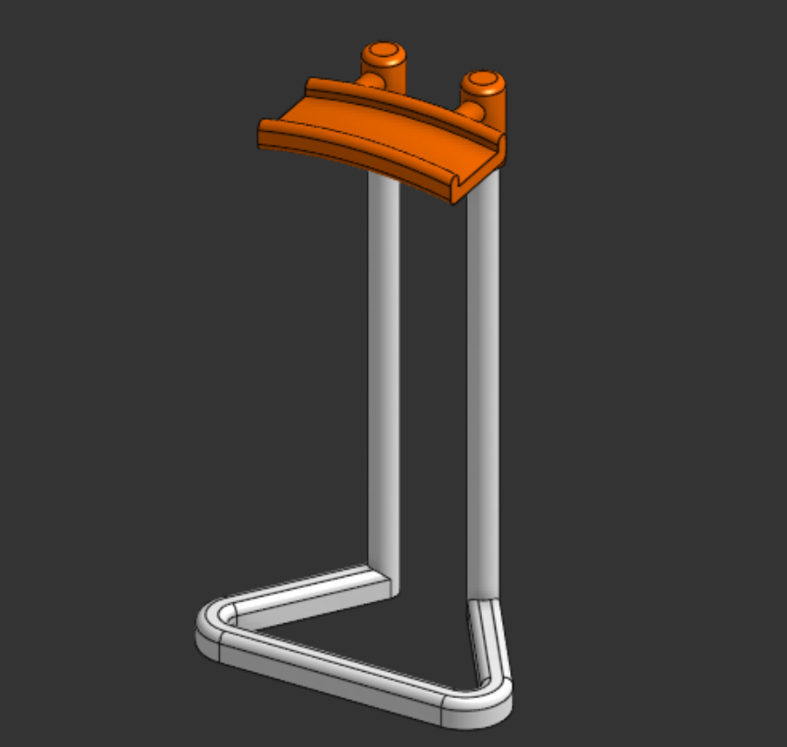

# headset-stand
Headset Stand is a simple and lightweight stand to mount your headset when unused.

## What is this?
Headset Stand is a minimal, sleek stand to mount your headset when you're not using it, keeping your desk organized. Designed from scratch in Onshape, this stand is compatible with various headset types. It has a ground clearance height of ~20 cm, high enough for big headsets.



## Repository Structure
```text
headset-stand/
1] Assets/----> All the images and visual references of the project
2] Hardware/--> Source design files
3] BOM.csv----> Bill of materials
4] LICENSE----> MIT License
5] README.md --> Detailed project documentation and instructions
```

## Live 3d view in Onshape
Click [here](https://cad.onshape.com/documents/4886047b3dee1e8d855dfb55/w/a65c90123d7fdf1be23a46ad/e/8a09ed6bcfe2c30df13839ed) to view Headset Stand in Onshape!

## How to get your own Headset Stand?
1. Download the source CAD .step files from the [Hardware](Hardware/) directory
2. Import the file into your CAD editor and make edits as you want (Optional)
3. Go to your fabricater/ manufacturer website, get a quote, and purchase it (For Example, [ROBU](https://robu.in) or [JLCPCB](https://jlcpcb.com))
4. Wait for it to arrive
5. For assembling it, you will need superglue
6. As seen in the reference image, you can apply a small amount of superglue (Optional) in the stem and holder to lock them in
7. That's it! Mount your headset!

## [BOM](BOM.csv) as a table
| Item     | Description | Quantity | Price (USD) | Link                             |
|----------|-------------|----------|-------------|----------------------------------|
| 3D print | PLA (85 gm) | 1        | 4.5         | https://printlegion.hackclub.com |
| Shipping |             |          | 1           |                                  |
| Total    |             |          | 5.5         |                                  |

## Fabrication Specs
1. Printer- 0.2 mm Standard Quality
2. Material- PLA
3. Color- Orange & White
4. Infill- 60%

## License
[MIT](LICENSE)- Use, modify, share as you like!

## Notes
- If ya'll like this project, make sure to see my other projects [Phone Stand](https://github.com/vd-sh/phone-stand), [Keeb Stand](https://github.com/vd-sh/keeb-stand), or [Cync](https://github.com/vd-sh/cync)
- Or simply visit my [profile](https://github.com/vd-sh) to see the latest projects :)
